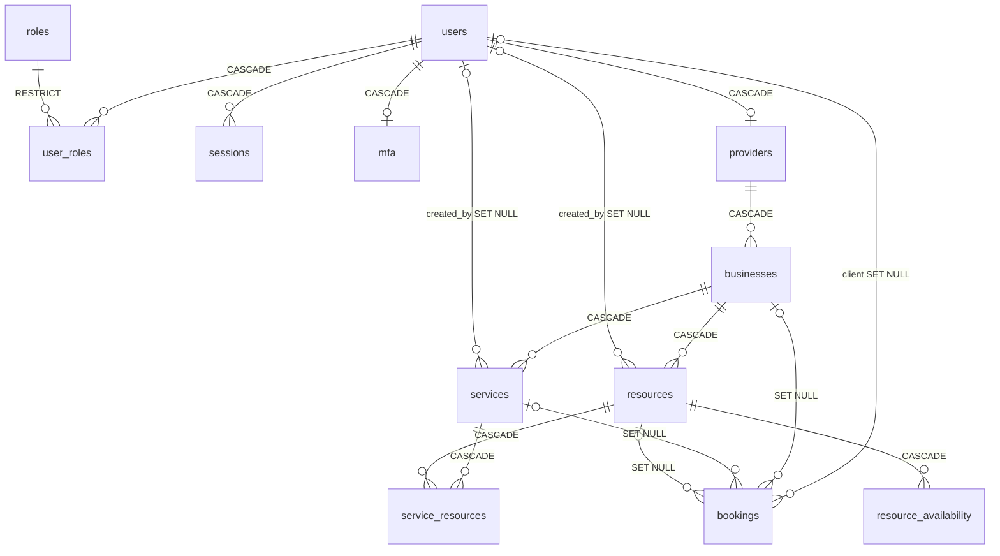

# Modelo de datos — Sprint 2 (MER, lógico y físico)

Responsable BD: Juan Sebastián Andraus López · PostgreSQL 16 · **Fuente de verdad: migraciones Flyway `V1`–`V12`** (`reservas-backend/src/main/resources/db/migration/`).

Este documento describe el esquema que la aplicación **realmente** aplica (BD-01, BD-02, BD-03). Reemplaza la versión anterior del Sprint 2 (tablas `reservations`, `resource_schedules`, `resource_blocks` con `BIGSERIAL`), que era un diseño paralelo nunca aplicado. Los documentos del Sprint 1 (`01_…`, `02_…`, `03_…`, `script_inicial.sql`) quedan como histórico; la conciliación está en [`conciliacion-modelo-bd-sprint-1.md`](../../conciliacion-modelo-bd-sprint-1.md) y las convenciones en [`convenciones-bd.md`](../convenciones-bd.md).

## 1. MER

Diagrama: [`ER_sprint2.png`](ER_sprint2.png) · [`ER_sprint2.svg`](ER_sprint2.svg) (fuente `ER_sprint2.dot`, se regenera con `dot -Tpng -Gdpi=110 ER_sprint2.dot -o ER_sprint2.png`).

| Entidad (tabla) | Migración | HU | Razón de existir |
|---|---|---|---|
| NEGOCIO (`businesses`) + antelación | V3, V6 | HU-08 | `min_advance_hours`: horas mínimas para reservar (1–720, por defecto 1) |
| SERVICIO (`services`) | V5 | HU-09, 13 | Oferta del negocio: duración, precio en pesos, activo |
| RECURSO (`resources`) | V7 | HU-14, 16, 17 | Elemento reservable (SALA, EQUIPO, PERSONAL); se desactiva, no se borra |
| SERVICIO_RECURSO (`service_resources`) | V8 | HU-18 | N:M servicio ↔ recurso; el PUT reemplaza el conjunto |
| DISPONIBILIDAD (`resource_availability`) | V9 | HU-19, 20 | Horario semanal por recurso (hora local de Bogotá) |
| RESERVA (`bookings`) | V10, V11, V12 | HU-22…28 | Registro histórico autosuficiente: copias + referencias que pasan a NULL (ADR-006) |

**Cardinalidades:** NEGOCIO 1 — 0..N SERVICIO / RECURSO · SERVICIO N — M RECURSO · RECURSO 1 — 0..N DISPONIBILIDAD · USUARIO 0..1 — 0..N RESERVA (cliente; NULL tras eliminar la cuenta) · NEGOCIO/SERVICIO/RECURSO 0..1 — 0..N RESERVA. La reserva **no** depende de `service_resources`: cambiar los recursos de un servicio (HU-18) no toca el historial.

## 2. Modelo lógico y físico (Sprint 2)

**businesses** (+ V6): `min_advance_hours INT NOT NULL DEFAULT 1` · `ck_businesses_min_advance_hours CHECK (1–720)`

**services** (V5): `id UUID PK DEFAULT gen_random_uuid()` · `business_id UUID NOT NULL → businesses ON DELETE CASCADE` · `name VARCHAR(150) NOT NULL` · `description VARCHAR(500)` · `duration_minutes INT NOT NULL ck >0` · `price_cop BIGINT NOT NULL ck ≥0` · `active BOOLEAN NOT NULL DEFAULT true` · `created_by UUID → users ON DELETE SET NULL` · `created_at, updated_at TIMESTAMPTZ NOT NULL` · `uk_services_business_name (business_id, lower(name))` · `idx_services_business_id`

**resources** (V7): `id` · `business_id → businesses CASCADE` · `name VARCHAR(150)` · `type VARCHAR(20) ck IN (SALA, EQUIPO, PERSONAL)` · `active` · `created_by → users SET NULL` · `created_at, updated_at` · `uk_resources_business_name (business_id, lower(name))` · `idx_resources_business_id`

**service_resources** (V8): PK `(service_id, resource_id)` · `service_id → services CASCADE` · `resource_id → resources CASCADE` · `created_at` · `idx_service_resources_resource_id`. Que ambos sean del mismo negocio lo valida la aplicación.

**resource_availability** (V9): `id` · `resource_id → resources CASCADE` · `day_of_week INT ck 1–7 (ISO, 1 = lunes)` · `start_time, end_time TIME ck start < end` · `created_at` · `idx_resource_availability_resource_day (resource_id, day_of_week)`. Rangos semiabiertos `[inicio, fin)`; que no se traslapen en un mismo día lo valida la aplicación con bloqueo de la fila del recurso.

**bookings** (V10–V12):

| Columna | Tipo | Regla |
|---|---|---|
| `id` | UUID | PK |
| `client_id`, `business_id`, `service_id`, `resource_id` | UUID NULL | FK → users / businesses / services / resources, **ON DELETE SET NULL** |
| `client_email`, `client_name` (V11), `business_name`, `service_name`, `resource_name` | VARCHAR(150) NOT NULL | **copias** del momento de reservar |
| `price_cop` | BIGINT NOT NULL | copia del precio; `ck ≥ 0` |
| `start_at`, `end_at` | TIMESTAMPTZ NOT NULL | `ck end_at > start_at` |
| `status` | VARCHAR(20) | `CONFIRMADA` (defecto) · `CANCELADA` · `COMPLETADA` |
| `cancel_origin` (V12) | VARCHAR(30) | `CLIENTE` · `PROVEEDOR` · `ELIMINACION_CUENTA` · `RECURSO_NO_DISPONIBLE` · `SERVICIO_NO_DISPONIBLE` |
| `cancel_reason` | VARCHAR(500) | texto libre de quien cancela |
| `created_at`, `cancelled_at` | TIMESTAMPTZ | |

Restricción clave: `ex_bookings_no_overlap EXCLUDE USING gist (resource_id WITH =, tstzrange(start_at, end_at) WITH &&) WHERE (status = 'CONFIRMADA' AND resource_id IS NOT NULL)` (extensión `btree_gist`).

## 3. Índices y consulta que soportan

| Índice | Consulta (`docs/bd/consultas/consultas_sprint2.sql`) |
|---|---|
| `ex_bookings_no_overlap` (GiST) | Anti-overbooking; disponibilidad C03/C04; ¿recurso ocupado? C05; conteo HU-16 C10 |
| `idx_bookings_client_id (client_id, start_at)` | Mis reservas C07 (recorrido hacia atrás); cancelación por eliminación de cuenta C11 |
| `idx_bookings_business_id (business_id, start_at)` | Reservas del negocio C08; cancelación de los negocios del proveedor C11 |
| `idx_bookings_resource_start (resource_id, start_at)` | SET NULL al borrar recurso; alternativa a la GiST |
| `uk_services_business_name`, `uk_resources_business_name` | Nombre único sin mayúsculas (409) y búsqueda por negocio |
| `idx_resource_availability_resource_day` | Horario de un recurso en un día (C02) |
| `idx_service_resources_resource_id` | Servicios de un recurso; cascada al borrar recurso |
| **Falta:** índice por `bookings.service_id` | SET NULL al borrar servicios (HU-28 proveedor): hoy recorre la tabla. Propuesta V13 |

## 4. Reglas: dónde se garantizan

| Regla | En la base | En la aplicación |
|---|---|---|
| Un recurso no tiene dos reservas confirmadas traslapadas | `ex_bookings_no_overlap` (23P01 → 409) | Consulta previa para el mensaje claro + bloqueo del recurso |
| Reserva dentro del horario, con antelación mínima, duración del servicio, recurso y servicio activos | — | `BookingServiceImpl` con `Clock` (America/Bogota) |
| Horarios sin traslape por día | — (solo forma: día 1–7, inicio < fin) | Bloqueo de fila del recurso |
| Servicio y recurso del mismo negocio | — | `ServiceResourceAssignmentServiceImpl` |
| Nombre único por negocio | `uk_*_business_name` | Mensaje 409 |
| Estados y orígenes válidos | `ck_bookings_status`, `ck_bookings_cancel_origin` | Solo se cancela una CONFIRMADA (completada o ya cancelada → 409) |
| Historial al eliminar | `SET NULL` + copias `NOT NULL` | Cancelación masiva antes de borrar (C10, C11) |
| Eliminación de cuenta limpia sus datos | `CASCADE` en sesiones, MFA, roles, proveedor → negocio → servicios/recursos | Solo el administrador (HU-05/28) |

## 5. Normalización

3FN en las entidades. En `bookings` hay **desnormalización intencional**: las copias (`client_email`, `client_name`, `business_name`, `service_name`, `resource_name`, `price_cop`) no son dependencias transitivas sino el **valor del momento de reservar**; existen para que el historial no cambie si se edita el servicio y sobreviva cuando las FK pasan a NULL (ADR-006). `audit_logs` no tiene FK a `users` por la misma razón.
