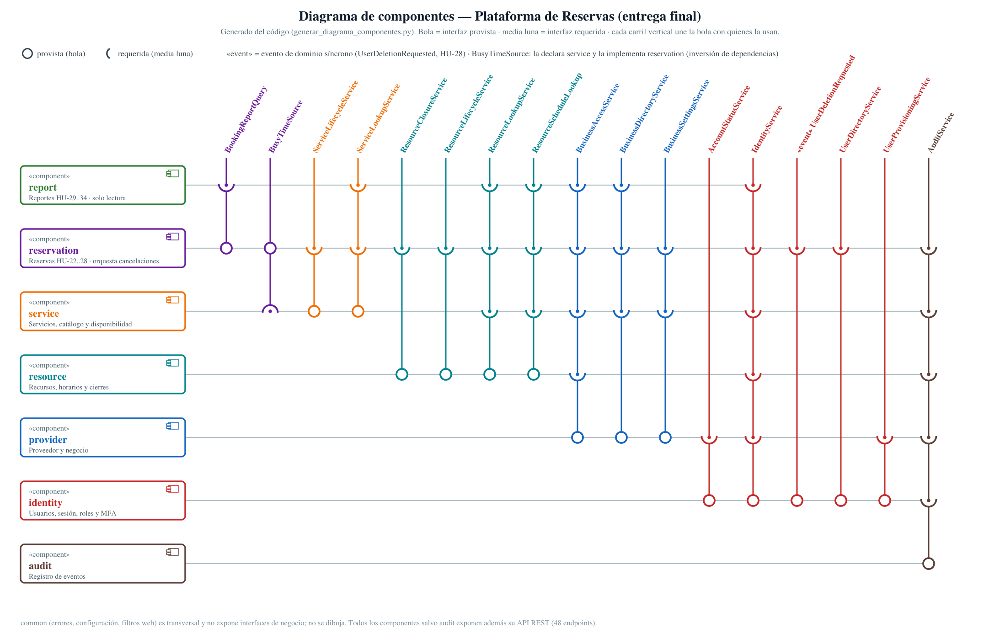
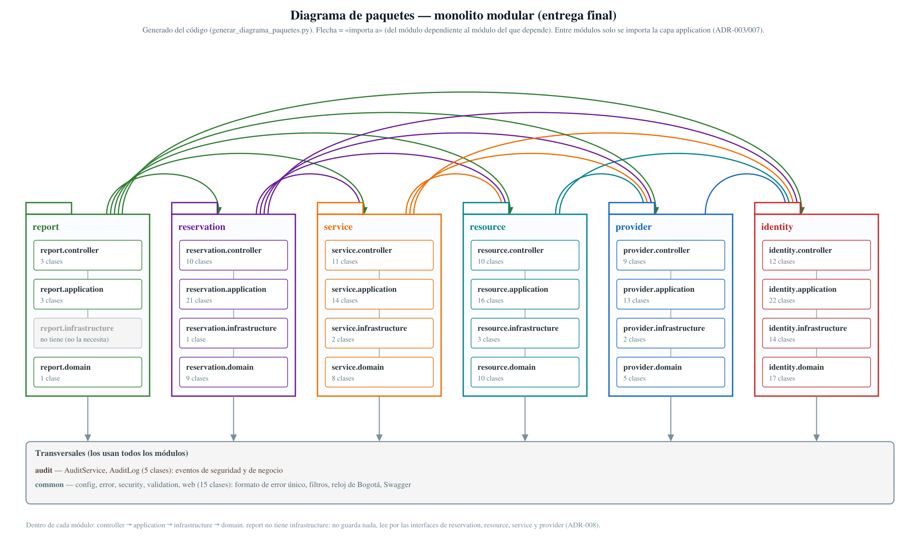
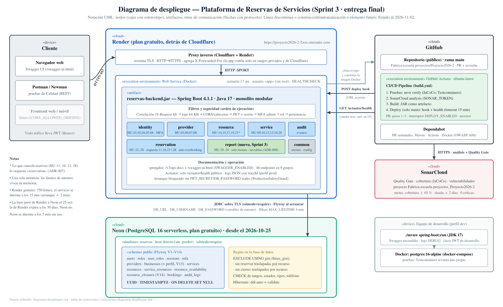

# Informe final — Plataforma de Reservas de Servicios

**Fábrica Escuela / CodeF@ctory UdeA · Arquitectura de Software · semestre 2026-2**
Equipo de Arquitectura: Simon Betancur, Juan Esteban González, Santiago Rendón · Bases de Datos: Juan Sebastián Andraus y los tres anteriores · Calidad: 7 integrantes.
Documento vivo: estado al **2026-11-02** (Sprint 3 en curso). Lo que cambie hasta la entrega se anota en [`handoff-contexto.md`](../sprint-2/handoff-contexto.md) §9.

## 1. Resumen

Construimos el **backend REST** de una plataforma donde **proveedores** (barberías, consultorios, canchas…) publican servicios y recursos con horarios, y **clientes** reservan sin que dos personas ocupen el mismo recurso a la misma hora. Es un **monolito modular** en Spring Boot 4.1.1 / Java 17 con PostgreSQL 16, desplegado en Render (cómputo) y Neon (base de datos), con integración y despliegue continuos en GitHub Actions.

| Indicador | Valor |
|---|---|
| Historias de usuario implementadas | **34** (HU-01 a HU-34): 6 del Sprint 1, 22 del Sprint 2 (15 en el sprint + 7 al inicio del Sprint 3) y 6 del Sprint 3 |
| Endpoints REST | **48**, todos documentados en Swagger (9 grupos) |
| Módulos | 6 de negocio (`identity`, `provider`, `service`, `resource`, `reservation`, `report`) + 2 transversales (`audit`, `common`), **sin ciclos** |
| Base de datos | 14 tablas, 14 migraciones Flyway (V1–V14), 2 restricciones `EXCLUDE` |
| Pruebas automáticas | **815** (471 unitarias + 344 de integración contra PostgreSQL real), todas en verde |
| Cobertura | **97,6 % de líneas / 91,7 % de ramas** (JaCoCo; meta del curso ≥ 65 %) |
| SonarCloud | **Quality Gate OK**: 0 bugs, 0 vulnerabilidades, 0 *code smells*, deuda 0 min, A en fiabilidad, seguridad y mantenibilidad (2026-11-03) |
| Postman en el servicio desplegado | 119 peticiones, 166 aserciones, **0 fallos** contra Render + Neon (2026-11-03) |
| Decisiones registradas | 8 ADR + 32 supuestos documentados (S-01…S-32) + 13 del Sprint 3 (D1…D13) |

## 2. Alcance por sprint

| Sprint | Qué se entregó | Evidencia |
|---|---|---|
| **1** (HU-01..06) | Registro de cliente y de proveedor con su negocio, login con JWT de 1 h, cierre de sesión (revoca), roles y permisos de administración, acceso según rol y pertenencia, base de MFA y auditoría | [`verificacion-criterios-aceptacion-sprint-1.md`](../verificacion-criterios-aceptacion-sprint-1.md) (39 criterios) |
| **2** (HU-07..28) | Catálogo, servicios, recursos, horarios, disponibilidad pública, **reservas con anti-overbooking**, consultas, cancelaciones (cliente, proveedor, desactivación y eliminación de cuenta), antelación mínima. Además: MFA obligatorio para administradores (ADR-004), corrección de 4 bugs de Calidad (#8–#11), Swagger, CI/CD, Sonar, revisión OWASP, Postman (88 peticiones, 0 fallos en Render) | [`informe-arquitectura-sprint-2.pdf`](../sprint-2/informe-arquitectura-sprint-2.pdf) |
| **3** (pendientes + HU-29..34) | Editar negocio, servicio y recurso; desactivar/reactivar servicio; **cierres puntuales** de recursos; completar reserva; y el **módulo de reportes** (ocupación, reservas por estado, servicios más reservados, valor, resumen de plataforma) | [`plan-de-trabajo-sprint-3.md`](../sprint-3/plan-de-trabajo-sprint-3.md), [`endpoints-sprint-3.md`](../api/endpoints-sprint-3.md) |

## 3. Arquitectura

### 3.1 Estilo: monolito modular

Un solo artefacto desplegable (`reservas-backend.jar`) dividido en **módulos por dominio**, cada uno con sus capas `controller → application → infrastructure → domain`. Se eligió sobre microservicios porque el equipo es de tres personas, el despliegue es uno solo y los dominios están muy relacionados (una reserva toca servicio, recurso, horario, negocio y cliente); los cortes por módulo dejan abierta una separación futura ([ADR-001](../arquitectura/adr/ADR-001-monolito-modular.md)).

**Reglas de modularidad** ([ADR-003](../arquitectura/adr/ADR-003-modularidad-e-interfaces.md), [ADR-007](../arquitectura/adr/ADR-007-comunicacion-entre-modulos-y-eventos.md)), verificadas por un script sobre el código ([`verificar_dependencias.py`](../arquitectura/verificar_dependencias.py)):

1. Un módulo solo usa de otro las **interfaces de su capa `application`** (17 interfaces, 36 conexiones en el diagrama, que se genera del código). Nunca sus entidades ni repositorios.
2. **Sin `@ManyToOne` entre módulos**: las referencias son columnas `UUID` con `REFERENCES` en SQL.
3. **Grafo acíclico:** `identity ← provider ← resource ← service ← reservation ← report` (y `audit` abajo de todos).
4. Lo que cruza módulos lo **orquesta el de más arriba**: desactivar un servicio o un recurso, o cerrar un recurso, lo hace `reservation` porque es el que puede cancelar reservas.
5. Dos mecanismos para no invertir el grafo: **inversión de dependencias** (`service` declara `BusyTimeSource` y `reservation` la implementa, para que la disponibilidad descuente reservas) y un **evento de dominio síncrono** (`identity` publica `UserDeletionRequested`; `reservation` cancela las reservas en la misma transacción).

### 3.2 Despliegue

Cliente → Cloudflare/Render (TLS) → contenedor Docker sin root → PostgreSQL 16 en **Neon** por JDBC con TLS. GitHub Actions corre pruebas, Sonar y build; en `main` llama al *deploy hook* de Render y espera `/actuator/health`. Detalle: [`conexiones-diagrama-despliegue.md`](../arquitectura/diagramas/conexiones-diagrama-despliegue.md).

### 3.3 Modelo de datos

14 tablas con UUID, `TIMESTAMPTZ` y `ON DELETE` explícito ([`convenciones-bd.md`](../bd/convenciones-bd.md), MER en [`docs/bd/modelo/`](../bd/modelo)). Reglas que **viven en la base** y no se pueden saltar desde el código: `EXCLUDE USING gist` para no tener dos reservas confirmadas traslapadas por recurso (V10) ni dos cierres traslapados (V14), `CHECK` de rangos, estados, tipos, precios y teléfono, únicos por negocio sin distinguir mayúsculas. Hibernate valida el esquema al arrancar (`ddl-auto: validate`).

## 4. Decisiones de arquitectura

| ADR | Decisión | Por qué (y qué se descartó) |
|---|---|---|
| [001](../arquitectura/adr/ADR-001-monolito-modular.md) | Monolito modular | Equipo y plazo pequeños; microservicios añadían red, despliegues y consistencia distribuida sin beneficio |
| [002](../arquitectura/adr/ADR-002-autenticacion-y-sesiones.md) | JWT de 1 h + tabla de sesiones | Sin estado pero **revocable** (el logout funciona de verdad); se descartó JWT puro (no se puede revocar) y sesión en servidor (estado) |
| [003](../arquitectura/adr/ADR-003-modularidad-e-interfaces.md) | Módulos que se hablan por interfaces | Bajo acoplamiento, reemplazables, probables con dobles |
| [004](../arquitectura/adr/ADR-004-politica-mfa.md) | MFA TOTP obligatorio para administradores; código en operaciones sensibles (`X-MFA-Code`); 5 fallos → 429 | Rol de mayor impacto; para clientes y proveedores sería fricción sin riesgo que la justifique |
| [005](../arquitectura/adr/ADR-005-anti-overbooking-y-concurrencia.md) | Anti-overbooking **en la base** (`EXCLUDE`) + bloqueos de fila | Una verificación en memoria no es atómica entre peticiones simultáneas; probado con concurrencia real |
| [006](../arquitectura/adr/ADR-006-historial-snapshots-y-cancelaciones.md) | Copias («snapshots») en la reserva y `ON DELETE SET NULL`; cancelación = estado + origen + motivo | Borrar o editar cuentas, servicios o negocios no rompe ni altera el historial; no se multiplican estados |
| [007](../arquitectura/adr/ADR-007-comunicacion-entre-modulos-y-eventos.md) | Interfaces de consulta, orquestar arriba, evento síncrono | Grafo sin ciclos y operaciones todo-o-nada |
| [008](../arquitectura/adr/ADR-008-modulo-de-reportes.md) | Reportes como módulo de **solo lectura sin tablas** | La base agrega; nadie duplica datos que sincronizar |

Estado: 001–003 aceptados; **004–008 «Propuesto»** hasta que el equipo los ratifique. Los supuestos (qué interpretamos de cada HU y quién debe confirmarlo) están en [`decisiones-y-supuestos-sprint-2.md`](../arquitectura/decisiones-y-supuestos-sprint-2.md) y en el plan del Sprint 3 §3.

## 5. Atributos de calidad y cómo se logran

| Atributo | Escenario | Táctica / mecanismo | Evidencia |
|---|---|---|---|
| **Integridad / consistencia** | Dos clientes reservan el mismo recurso y hora al mismo tiempo | Restricción `EXCLUDE` + bloqueo de fila; 409 al perdedor | `BookingCreationIntegrationTest` (`[201, 409]`) |
| **Consistencia entre módulos** | Se desactiva un servicio mientras alguien reserva | Bloqueo compartido del servicio (`FOR SHARE`) en la reserva y exclusivo en la desactivación | `ServiceEditAndLifecycleIntegrationTest` (carrera) |
| **Seguridad** | Robo de contraseña de un administrador | MFA TOTP obligatorio, código en operaciones sensibles, límite de intentos | `MfaFlowIntegrationTest` (14 casos) |
| **Seguridad** | Un proveedor intenta tocar el negocio de otro | Rol (`@PreAuthorize`) + **pertenencia** (`BusinessAccessService.requireOwner`) en cada operación | Pruebas 403 en cada HU |
| **Trazabilidad** | Un error en producción | `traceId` en cada respuesta de error y en los logs JSON; auditoría de eventos | `WebHardeningIntegrationTest` |
| **Mantenibilidad / modificabilidad** | Agregar los reportes del Sprint 3 | Módulo nuevo encima del grafo sin tocar el esquema ni los módulos existentes (solo nuevas consultas) | Diagrama de paquetes generado del código |
| **Disponibilidad (limitada)** | El plan gratuito agota sus horas | Base movida a Neon sin cambiar código; interruptor `DEPLOY_ENABLED` y tiempos límite en el pipeline | [`guia-recuperar-despliegue.md`](../guia-recuperar-despliegue.md) |
| **Probabilidad (testability)** | Lógica dependiente de la hora | Reloj inyectable (`Clock` de Bogotá) y Testcontainers con PostgreSQL real | 815 pruebas |

## 6. Seguridad (OWASP Top 10)

Revisión de código con correcciones y sondeos al servicio desplegado (no es una prueba de penetración): [`owasp-top10-sprint-2.md`](../seguridad/owasp-top10-sprint-2.md). Principales controles: control de acceso por rol **y** pertenencia (A01); BCrypt, TLS, JWT firmado (A02); validación con límites, consultas parametrizadas (A03); límites de intentos por **IP real** detrás de Cloudflare (A04/A07); cabeceras CSP/Referrer/Permissions, CORS cerrado, cuerpo máx. 64 KB, contenedor sin root, arranque bloqueado con claves de relleno (A05); Dependabot (A06); MFA (A07); pipeline con revisión (A08); auditoría y `traceId` (A09). Pendientes: anti-replay y cifrado del secreto MFA, recuperación de MFA, límite de tasa en rutas públicas, proteger `main`.

## 7. Calidad y pruebas

* **Pirámide:** pruebas unitarias con JUnit 5 + Mockito (patrón AAA) para reglas y cálculos; de integración con Spring completo y **PostgreSQL real en Testcontainers** (migraciones Flyway incluidas) para flujos, seguridad y concurrencia.
* **Concurrencia probada de verdad:** reservas simultáneas, cancelaciones dobles, cierres traslapados, reserva contra desactivación (repetida 8 veces por corrida).
* **Pruebas de la documentación:** `OpenApiDocumentationIntegrationTest` hace fallar el build si un endpoint nuevo no está en Swagger.
* **Sonar** con Quality Gate (cobertura ≥ 65 %, deuda ≤ 2 días, complejidad < 50, 0 vulnerabilidades críticas) en cada push; **Postman/Newman** contra el servicio desplegado ([`docs/postman/`](../postman/README.md)).
* Resultados por sprint: [`resultados-pruebas-sprint-1.md`](../resultados-pruebas-sprint-1.md), [`resultados-pruebas-sprint-2.md`](../resultados-pruebas-sprint-2.md).

## 8. CI/CD y despliegue

[`build.yml`](../../.github/workflows/build.yml): (1) pruebas + JaCoCo, (2) SonarCloud, (3) build del JAR, (4) solo en `main`: *deploy hook* de Render y *smoke test* a `/actuator/health` con tiempos límite. Trunk-based con ramas cortas y PR. Secretos solo en GitHub Secrets y en variables de Render (el repositorio es público).

## 9. Lecciones del semestre (problemas reales y cómo se resolvieron)

| Problema | Causa | Lección / solución |
|---|---|---|
| `main` roto el 13-sep | Subida con «Add files via upload» (sin PR): se perdió una dependencia y se filtró una clave | Nunca subir por la web; `git revert` en vez de reescribir historia; rotar la clave |
| Flyway no corría | Spring Boot 4 movió la autoconfiguración a `spring-boot-flyway` | Leer las notas de migración del framework |
| Lombok no generaba código | JDK 24 en lugar de 17 | Fijar la versión del JDK del proyecto |
| Pruebas de integración «sin Docker» | Testcontainers 1.21.3 no habla con Docker Engine 29 | Actualizar (hoy 2.0.5) |
| Auditoría de rechazos perdida | El rollback de la transacción se llevaba el evento | `noRollbackFor` en los servicios que auditan y lanzan |
| Reserva confirmada en un recurso inactivo | Hibernate devolvía la copia en memoria aunque la fila estuviera bloqueada | Leer el valor bajo bloqueo con consulta nativa (`lockAndReadActive`) |
| Límites «por IP» casi globales en Render | Render está detrás de Cloudflare: la app veía la IP del borde | Confiar solo en los rangos de Cloudflare; verificado con `audit_logs` |
| Pipeline colgado horas | `curl` sin tiempo límite contra un servicio suspendido | `-m`, `timeout-minutes`, `concurrency` e interruptor `DEPLOY_ENABLED` |
| Servicio caído el 24-oct | Se agotó el plan gratuito de Render (750 h, base de 30 días) | Base a Neon sin tocar el código (gracias a la configuración por variables de entorno) |

## 10. Limitaciones y trabajo futuro

* **Una sola instancia:** los límites de intentos viven en memoria; con varias instancias habría que llevarlos a Redis o a la base.
* **MFA:** falta anti-replay, cifrado del secreto en reposo y recuperación por otro administrador.
* **Reportes:** usan el horario vigente (no hay historial de horarios); para volúmenes grandes, vista materializada.
* **Notificaciones:** los «avisos» a clientes y proveedores son eventos de auditoría; un servicio de correo sería el siguiente paso.
* **Gobierno:** ratificar ADR-004..008, proteger `main` con revisión obligatoria y CI verde.
* **Plataforma:** el plan gratuito duerme el servicio; observabilidad (Prometheus/Grafana) y orquestación quedan como evolución.

## 11. Dónde está cada cosa

| Tema | Documento |
|---|---|
| Endpoints, roles y DTO (generado del código) | [`referencia-api-sprint-2.md`](../api/referencia-api-sprint-2.md) |
| Contratos y errores | [`endpoints-sprint-3.md`](../api/endpoints-sprint-3.md), [`errores-api-sprint-2.md`](../api/errores-api-sprint-2.md), [`guia-swagger-openapi.md`](../api/guia-swagger-openapi.md) |
| Arquitectura y ADR | [`docs/arquitectura/`](../arquitectura) |
| Guía para la sustentación | [`guia-sustentacion.md`](guia-sustentacion.md) |
| Correr local, desplegar, probar lo desplegado | [`guia-desarrollo-local.md`](../guia-desarrollo-local.md), [`guia-despliegue-render.md`](../guia-despliegue-render.md), [`guia-prueba-aplicacion-desplegada.md`](../guia-prueba-aplicacion-desplegada.md) |
