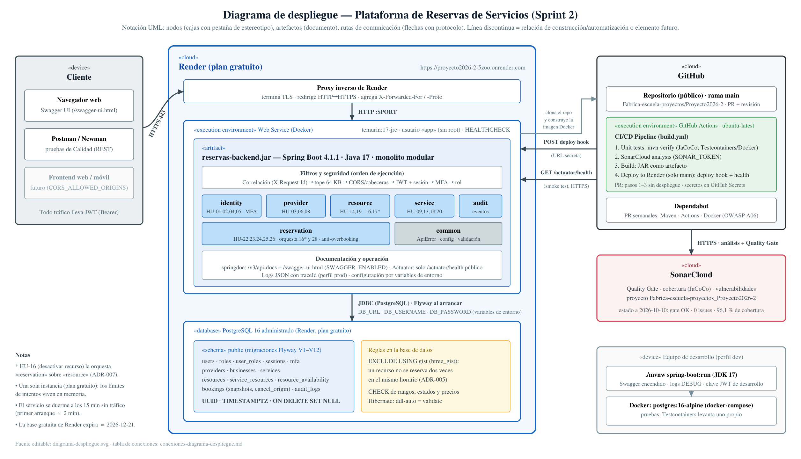

# Informe Sprint 2 — Arquitectura de Software

**Proyecto:** Plataforma de Reservas de Servicios (Caso 14) · **Equipo de Arquitectura:** Simon Betancur, Juan Esteban González, Santiago Rendón · **Fecha:** 13 de octubre de 2026
**Repositorio:** <https://github.com/Fabrica-escuela-proyectos/Proyecto2026-2> · **Aplicación desplegada:** <https://proyecto2026-2-5zoo.onrender.com> · **API interactiva (Swagger):** <https://proyecto2026-2-5zoo.onrender.com/swagger-ui.html>

> **Cómo leer este informe:** cada sección corresponde a un entregable del curso (Lineamientos §3.7), abre con su estado y termina con una tabla de **evidencias** con enlaces a los documentos y al código de origen. Las rutas son relativas al repositorio.

## Resumen

| # | Entregable del Sprint 2 | Estado | Evidencia clave |
|---|---|---|---|
| 1 | Diagrama de despliegue | **Cumplido** | [§1](#1-diagrama-de-despliegue) |
| 2 | APIs priorizadas | **Cumplido** (15 HU del Sprint 2 implementadas) | [§2](#2-apis-priorizadas) |
| 3 | Al menos tres APIs REST | **Cumplido**: 33 endpoints en 5 módulos | [§3](#3-apis-rest-mínimo-tres) |
| 4 | CI/CD inicial con GitHub Actions | **Cumplido** y desplegando; falta proteger `main` | [§4](#4-cicd-con-github-actions) |
| 5 | Vulnerabilidades con OWASP Top Ten | **Cumplido** como revisión con correcciones; quedan brechas priorizadas | [§5](#5-owasp-top-ten) |
| 6 | Documentación de las APIs | **Cumplido**: Swagger + referencia + errores + Postman | [§6](#6-documentación-de-las-apis) |
| — | Soporte: arquitectura y ADR · pruebas y calidad · pendientes | Ver secciones | [§7](#7-arquitectura-y-decisiones-adr) · [§8](#8-pruebas-y-calidad) · [§9](#9-pendientes-y-decisiones-abiertas) |

---

## 1. Diagrama de despliegue

**Qué muestra:** el cliente (navegador/Swagger, Postman) entra por HTTPS al proxy de **Render**, que lo pasa a un contenedor Docker con el JAR Spring Boot (usuario sin root, *healthcheck*), conectado por JDBC a **PostgreSQL 16** (12 migraciones Flyway, restricción anti-overbooking). **GitHub Actions** prueba, analiza en **SonarCloud**, construye y despliega a Render con un *deploy hook* secreto; **Dependabot** propone actualizaciones.

| Evidencia | Dónde |
|---|---|
| Diagrama (PNG y fuente editable SVG) | [`diagrama-despliegue.png`](../arquitectura/diagramas/diagrama-despliegue.png) · [`.svg`](../arquitectura/diagramas/diagrama-despliegue.svg) |
| Nodos, rutas de comunicación, variables de entorno y límites | [`conexiones-diagrama-despliegue.md`](../arquitectura/diagramas/conexiones-diagrama-despliegue.md) |
| Imagen del contenedor | [`reservas-backend/Dockerfile`](../../reservas-backend/Dockerfile) |
| Cómo se despliega | [`guia-despliegue-render.md`](../guia-despliegue-render.md) |

## 2. APIs priorizadas

**Criterio:** entregar primero el flujo completo de reserva de punta a punta (configurar el negocio → ver horarios libres → reservar → cancelar) antes de ampliar el catálogo.

| Nivel | HU | Estado |
|---|---|---|
| **Tier 1 (compromiso)** | 08, 09, 13, 14, 18, 19, 20, 22, 23, 24, 25 | **Implementado y desplegado** |
| **Tier 2** | 16, 17, 26, 28 | **Implementado y desplegado** |
| Tier 3 (Sprint 3) | 07, 10, 11, 12, 15, 21, 27 | Fuera del alcance acordado |

| Evidencia | Dónde |
|---|---|
| Priorización, capacidad y justificación | [`plan-de-trabajo-sprint-2.md`](plan-de-trabajo-sprint-2.md) §2 |
| Supuestos que tomamos donde el criterio de aceptación no decía (S-01…S-32) | [`decisiones-y-supuestos-sprint-2.md`](../arquitectura/decisiones-y-supuestos-sprint-2.md) |

## 3. APIs REST (mínimo tres)

**33 endpoints REST** en 18 controladores y 5 módulos de negocio: 4 públicos, 8 para cualquier usuario autenticado, 15 de PROVEEDOR, 4 de CLIENTE y 2 de ADMINISTRADOR (con confirmación MFA).

| Módulo | Endpoints | Qué cubre (HU) |
|---|---:|---|
| `identity` | 8 | Registro de cliente, login/logout, MFA, roles, eliminación de cuentas (01, 02, 04, 05, 28) |
| `provider` | 5 | Registro de proveedor, perfil, antelación mínima (03, 06, 08) |
| `service` | 7 | Servicios, catálogo, recursos asignados, **disponibilidad pública** (09, 13, 18, 20) |
| `resource` | 6 | Recursos, horarios semanales, desactivar y reactivar (14, 19, 16, 17) |
| `reservation` | 7 | Crear, consultar y cancelar reservas (22, 23, 24, 25, 26) |

| Evidencia | Dónde |
|---|---|
| Matriz de los 33 endpoints con rol y todos los DTO (**generada del código**) | [`referencia-api-sprint-2.md`](../api/referencia-api-sprint-2.md) |
| Reglas de negocio y ejemplos por endpoint | [`endpoints-sprint-2.md`](../api/endpoints-sprint-2.md) |
| Código de los controladores | `reservas-backend/src/main/java/com/codefactory/reservas_backend/*/controller/` |

## 4. CI/CD con GitHub Actions

**Flujo:** `push` a `main` o *pull request* → **1.** pruebas (`mvn verify`, PostgreSQL real con Testcontainers) → **2.** SonarCloud (Quality Gate) → **3.** build del JAR → **4.** despliegue a Render y *smoke test* de `/actuator/health` (**solo `main`**). Último despliegue: ejecución **#37, los cuatro trabajos en verde** (2026-10-13). Dependabot abre PR semanales (Maven, Actions, Docker) que pasan por el mismo flujo.

| Evidencia | Dónde |
|---|---|
| Definición del pipeline | [`.github/workflows/build.yml`](../../.github/workflows/build.yml) |
| Ejecuciones | <https://github.com/Fabrica-escuela-proyectos/Proyecto2026-2/actions> |
| Análisis de calidad | <https://sonarcloud.io/project/overview?id=Fabrica-escuela-proyectos_Proyecto2026-2> |
| Actualización de dependencias | [`.github/dependabot.yml`](../../.github/dependabot.yml) |

**Brecha:** la rama `main` aún no tiene protección (PR obligatorio y revisión); está en el plan de cierre ([§9](#9-pendientes-y-decisiones-abiertas)).

## 5. OWASP Top Ten

**Método:** revisión de código y configuración, pruebas automáticas, sondeos de solo lectura al servicio desplegado y correcciones (**no es una prueba de penetración**).

| Riesgo | Estado | Qué hace la aplicación | Falta |
|---|---|---|---|
| A01 Control de acceso | Cubierto | Rol por ruta y pertenencia validada en el servicio para cada recurso | — |
| A02 Criptografía | Parcial | BCrypt, JWT firmado, TLS en Render | Rotar credencial de la cuenta demo (SEC-01); cifrar el secreto TOTP |
| A03 Inyección | Cubierto | Consultas parametrizadas y validación con límites en todo DTO | Más cargas de ataque |
| A04 Diseño inseguro | Parcial | Reglas en el servidor; anti-overbooking en la BD; límites de intentos **por IP real** (verificado en Render); tope de cuerpo de 64 KB | Límite de tasa en rutas públicas |
| A05 Configuración | Cubierto en código | Arranque que falla con claves de relleno; contenedor sin root; cabeceras CSP/Referrer/Permissions; CORS explícito | Swagger activo en Render (decisión del equipo) |
| A06 Componentes | Parcial | Dependabot semanal; `jjwt` 0.13.0; Testcontainers 2.0.5 | Escaneo de vulnerabilidades en el pipeline |
| A07 Autenticación | Parcial | Política de contraseña, bloqueo por fuerza bruta, **MFA TOTP** obligatorio a administradores | Cambio de contraseña, anti-replay del TOTP |
| A08 Integridad | Parcial | CI con pruebas y Sonar; migraciones Flyway inmutables | **Proteger `main`** |
| A09 Registro | Parcial | Auditoría sin secretos; `traceId`/`X-Request-Id` en errores y logs; logs JSON | Alertas |
| A10 SSRF | No aplica | El backend no hace llamadas salientes | — |

| Evidencia | Dónde |
|---|---|
| Matriz detallada, sondeos a Render (2026-10-10 y 2026-10-12) y plan de cierre con responsables | [`owasp-top10-sprint-2.md`](../seguridad/owasp-top10-sprint-2.md) |
| Política de MFA | [`ADR-004`](../arquitectura/adr/ADR-004-politica-mfa.md) |
| Pruebas de las correcciones | `reservas-backend/src/test/java/…/common/web/` (cabeceras, CORS, tamaño, `traceId`, IP reenviada) |

## 6. Documentación de las APIs

| Capa | Para qué sirve | Dónde |
|---|---|---|
| **Swagger UI** (OpenAPI 3.1) | Probar la API en vivo con *Authorize*: 33 operaciones en 8 grupos, con ejemplos y errores `ApiError` | <https://proyecto2026-2-5zoo.onrender.com/swagger-ui.html> · [`guia-swagger-openapi.md`](../api/guia-swagger-openapi.md) |
| **Referencia generada del código** | Matriz de acceso y catálogo de DTO (no se desactualiza) | [`referencia-api-sprint-2.md`](../api/referencia-api-sprint-2.md) |
| **Catálogo de errores** | Formato `ApiError`, `traceId`, mapa excepción→HTTP y mensaje esperado por HU | [`errores-api-sprint-2.md`](../api/errores-api-sprint-2.md) |
| **Colección de Postman** | 88 peticiones de extremo a extremo; ejecutable con Newman | [`docs/postman/`](../postman/README.md) |

## 7. Arquitectura y decisiones (ADR)

**Estilo:** monolito modular (Spring Boot 4.1.1 / Java 17 / PostgreSQL 16): un solo despliegue; módulos `identity ← provider ← resource ← service ← reservation` más `audit` y `common`, **sin ciclos** (verificado por script). Cada módulo se divide en `controller`/`application`/`infrastructure`/`domain` y se comunica con los demás solo por interfaces de la capa `application` y un evento de dominio.

| ADR | Decisión | Atributo de calidad | Estado |
|---|---|---|---|
| [001](../arquitectura/adr/ADR-001-monolito-modular.md) | Monolito modular | Simplicidad, mantenibilidad | Aceptado |
| [002](../arquitectura/adr/ADR-002-autenticacion-y-sesiones.md) | JWT de 1 h + tabla de sesiones | Seguridad, revocación | Aceptado |
| [003](../arquitectura/adr/ADR-003-modularidad-e-interfaces.md) | Módulos e interfaces | Modificabilidad | Aceptado |
| [004](../arquitectura/adr/ADR-004-politica-mfa.md) | MFA TOTP obligatorio para administradores | Seguridad | Propuesto |
| [005](../arquitectura/adr/ADR-005-anti-overbooking-y-concurrencia.md) | Anti-overbooking en la base de datos (`EXCLUDE` + bloqueos de fila) | Integridad bajo concurrencia | Propuesto |
| [006](../arquitectura/adr/ADR-006-historial-snapshots-y-cancelaciones.md) | Reservas con copias («snapshots») y cancelación = estado + origen | Trazabilidad | Propuesto |
| [007](../arquitectura/adr/ADR-007-comunicacion-entre-modulos-y-eventos.md) | Interfaces entre módulos y evento síncrono de eliminación | Bajo acoplamiento, atomicidad | Propuesto |

| Evidencia | Dónde |
|---|---|
| Arquitectura general e interfaces entre módulos | [`arquitectura-sprint-1.md`](../arquitectura/arquitectura-sprint-1.md) · [`interfaces-modulos-sprint-1.md`](../arquitectura/interfaces-modulos-sprint-1.md) |
| Diagramas de componentes y paquetes (+ conexiones) | [`docs/arquitectura/diagramas/`](../arquitectura/diagramas) |
| Comprobación de dependencias entre módulos | `python docs/arquitectura/verificar_dependencias.py` |
| Modelo de datos (12 migraciones Flyway) | [`db/migration/`](../../reservas-backend/src/main/resources/db/migration) · [`convenciones-bd.md`](../bd/convenciones-bd.md) |

## 8. Pruebas y calidad

| Medida | Valor | Fuente |
|---|---|---|
| Pruebas automáticas | **658**, 0 fallos (383 unitarias + 275 de integración con PostgreSQL real) | `./mvnw clean test` y el pipeline |
| Cobertura | **96,0 %** | SonarCloud |
| Quality Gate · issues · vulnerabilidades · deuda técnica | **OK** · 0 · 0 · 0 | SonarCloud |
| Prueba de extremo a extremo en el servicio desplegado | **88 peticiones, 119 aserciones, 0 fallos** (Render, 2026-10-12; incluye el flujo del administrador con MFA) | [`resultados-pruebas-sprint-2.md`](../resultados-pruebas-sprint-2.md) |
| Bugs de Calidad (#8 a #11) | Corregidos, con prueba de regresión | [`cierre-pendientes-sprint-1.md`](cierre-pendientes-sprint-1.md) |

## 9. Pendientes y decisiones abiertas

| Pendiente | Riesgo | Responsable |
|---|---|---|
| Proteger la rama `main` (PR + revisión + checks requeridos) | A08 | Simon (admin del repositorio) |
| Rotar la contraseña de la cuenta demo, publicada en una guía (SEC-01/02) | A02/A07 | Simon |
| Ratificar los ADR 004–007 (hoy «Propuesto», ya implementados) | Gobernanza | Los tres de Arquisoft |
| Límite de tasa en rutas públicas; escaneo de vulnerabilidades en el pipeline; mejoras de MFA (anti-replay, cifrado del secreto, recuperación) | A04/A06/A07 | Arquisoft |
| Preguntas a Calidad/PO que pueden cambiar lo construido: retención del nombre y correo en reservas históricas (S-27), anti-overbooking por recurso o por servicio (S-14), formato de error de los Lineamientos (S-28), cómo miden «complejidad < 50» | Alcance | Equipo con Calidad |
| HU de Tier 3 (07, 10, 11, 12, 15, 21, 27) y notificaciones; PNG del diagrama de paquetes aún del Sprint 1 | Alcance | Sprint 3 |

**Hacia el Sprint 3** (contenedores y orquestación, observabilidad con Grafana/Prometheus, refinamiento de APIs, pruebas de integración y aseguramiento con tokens): ya están adelantados la imagen Docker, los `traceId` y logs JSON, las 275 pruebas de integración y los tokens JWT con sesión revocable.

## Cómo verificar en 5 minutos

| Qué | Cómo |
|---|---|
| La aplicación está viva | `curl https://proyecto2026-2-5zoo.onrender.com/actuator/health` (puede tardar ≈ 2 min si estaba dormida) |
| La API y sus contratos | Abrir el [Swagger](https://proyecto2026-2-5zoo.onrender.com/swagger-ui.html) |
| Las 658 pruebas | `cd reservas-backend && ./mvnw clean test` (necesita Docker) |
| El flujo de extremo a extremo | `npx newman run docs/postman/Reservas-Sprint2.postman_collection.json -e docs/postman/Reservas-Render.postman_environment.json --timeout-request 150000` |
| Módulos sin ciclos | `python docs/arquitectura/verificar_dependencias.py` |

**Índice de todo lo demás:** [`entregable-arquitectura-sprint-2.md`](entregable-arquitectura-sprint-2.md) (mapa completo de evidencias) y [`handoff-contexto.md`](handoff-contexto.md) (bitácora del sprint).
